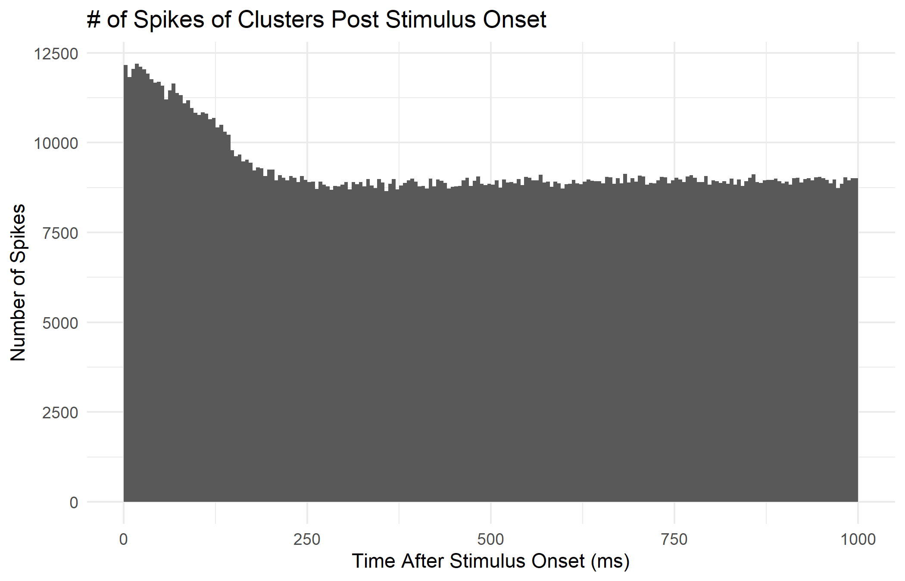
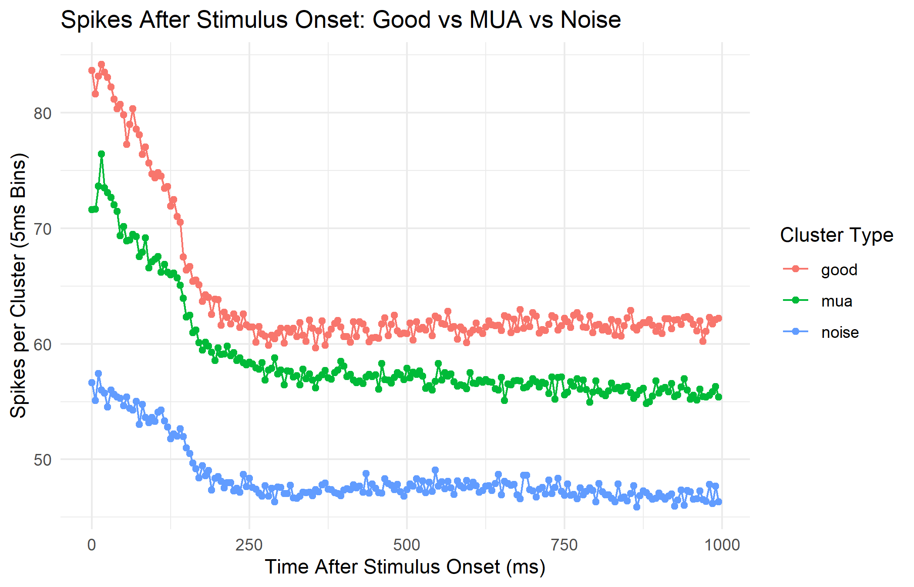
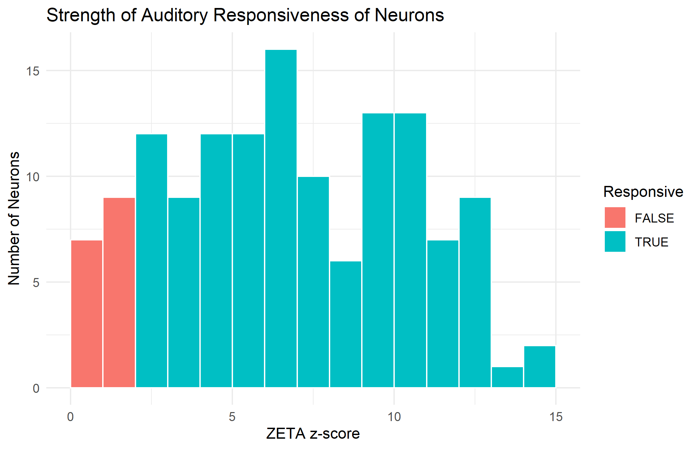
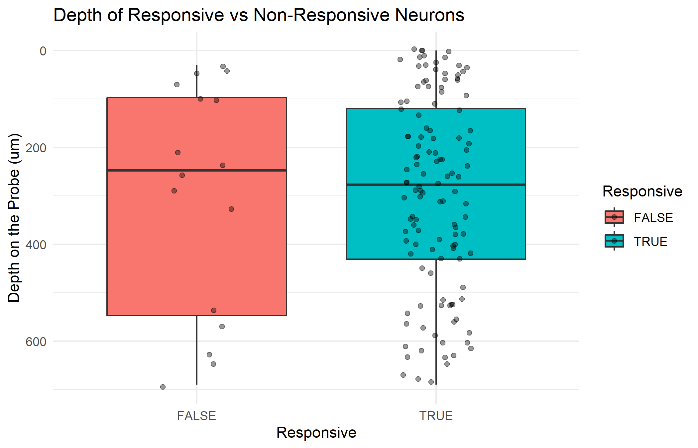

# The project at a glance

**Question.** Which neurons collected during a Neuropixels recording are auditory responsive? How many neurons are fast-responsive and how many are slow responsive?

**Data.**

| File in `data/raw/`       | Source (link)         | Format   | License / terms |
|-------------------|------------------|------------------|------------------|
| data/raw/cluster_info.csv | Neuropixels Recording | Wide CSV | n/a             |
| data/raw/trials.csv       | Neuropixels Recording | Long CSV | n/a             |
| data/raw/spikes_part1.csv | Neuropixels Recording | Long CSV | n/a             |
| data/raw/spikes_part2.csv | Neuropixels Recording | Long CSV | n/a             |

**Folders.**

```         
Final Project/
├── README.md               <- Instructions on running this pipeline
├── data/
    ├── raw/                <- original raw data
    └── processed/          <- data processed from pipeline
├── output/                 <- figures and tables created by analysis pipeline 
├── scripts/                <- scripts used in pipeline
└── Final Report.qmd/       <- this report
```

# Before you render (one time only)

1.  Open this folder in Positron (*File → Open Folder*).
2.  Install the exact package versions:

```{r}
#| label: restore
#| eval: false
renv::restore()
```

This first render downloads Python and packages necessary to run the ZETA test in this pipeline including: "numpy", "pandas", "scipy" and "zetapy".

# Step 1: Import Data

```{r}
#| label: import
source("scripts/read_data.R")
```

The two spike files in this dataset have `r format(nrow(spikes), big.mark = ",")` total rows. There are a total of `r nrow(clusters)` clusters and `r nrow(trials)` trials in this dataset.

# Step 2: Clean Data

```{r}
#| label: clean
source("scripts/clean_data.R")
```

This cleans the raw data file and keeps only the clusters marked as "good" and with at least 100 spikes. We want to throw away the noisy and multi-unit clusters (MUAs) as well as any low-spiking neurons. We are left with `r format(nrow(neurons), big.mark = ",")` good single-unit neurons with a total of `r format(nrow(spikes_neurons), big.mark = ",")` spikes.

# Step 3: Check Data Quality

```{r}
#| label: quality-check
#| include: false
source("scripts/quality_checks.R")
```

We want to use data visualizations to check the quality of the data collected. Before running the more intensive ZETA tests and beyond we want to make sure our neurons are biologically behaving in a manner we would expect them to.

```{r}
#| label: plot-fig1
#| fig-cap: "Figure 1: A histogram showing number of spikes in 5ms bins of only the good clusters post-stimulus onset. We should expect these neurons to have heightened spiking activity 0-100ms post stimulus onset followed by a relatively stable baseline from 100-1000ms."

```

```{r}
#| label: plot-fig2
#| fig-cap: "Figure 2: A comparision of all three cluster types including good neurons, MUAs and noise. We should expect to see good neurons have a strong timelocked response to stimulus onset compared to MUAs and noise."

```

# Step 4: ZETA Test

The ZETA test (Montijn et al., 2021) uses a cumulative distribution function to measure neuron responsiveness against baseline rate. It is a parameter free test to find responsive neurons in a large electrophysiological dataset like this. This chunk uses reticulate to load and run the ZETA test written originally in Python.

```{r}
#| label: python-setup
library(reticulate)
py_require(c("numpy", "pandas", "scipy", "zetapy"))
```

This next chunk in Python uses the spikes and trials from the .csv's in this project folder and then runs the ZETA test once for each neuron. Python code is taken from the ZETA repository (Montijn et al., 2021). Since this repeats per neuron, this chunk takes a while to run through everything.

```{python}
#| label: zeta-test
import pandas as pd      
from zetapy import zetatest

onsets = r.trials["ttl_time_s"].to_numpy()
rows = []
for unit, group in r.spikes_neurons.groupby("unit"):
    result = zetatest(group["time_s"].to_numpy(), onsets,
                      max_duration=1.0,
                      resampling_number=250,
                      random_seed=266)
    rows.append({"cluster_id": int(unit), "zeta_p": float(result[0]),
                 "zeta_z": float(result[1]["zeta_score"])})

zeta_results = pd.DataFrame(rows)
zeta_results.to_csv("data/processed/zeta_results.csv", index=False) # saves results to a .csv 
len(zeta_results)

```

Now we will run an R script that analyzes the zeta_results.csv (output of the ZETA test):

```{r}
#| label: zeta-results
source("scripts/zeta_test.R")
```

A neuron is found responsive if its p-value from the ZETA test is below 0.05. There are `r sum(zeta_neurons$responsive)` auditory-responsive neurons in this dataset.

```{r}
#| label: final-plots
#| include: false
source("scripts/zeta_test_plots.R")
```

```{r}
#| label: plot-fig3
#| fig-cap: "Figure 3: Uses ZETA test z-score to show strength of auditory responsivenes in our dataset. Here we see a very neat split showing that the non-auditory neurons (orange) have lower z-scores than auditory neurons (teal)."

```

```{r}
#| label: plot-fig4
#| fig-cap: "Figure 4: Location of the auditory neurons on the probe. Auditory neurons tend to sit deeper in the brain so we expect them to be on the lower ends of the probe. Here we see their depth is spread out showing that our probe was almost entirely in the auditory layer."

```

# How to render, and how to check it is reproducible:

``` bash
quarto render Final_Report.qmd
```

Delete `data/processed/` and content in `output/figures` and `output/tables`, restart R, and render again.

# Computational environment

```{r}
#| label: session-info
sessionInfo()
```

# AI and Other Resources Used:

- **AI Use**: Used Claude to help with identifying errors in my syntax and code (especially with help finding small typos leading to errors).
- **ZETA Test:** [Jorrit S Montijn, Koen Seignette, Marcus H Howlett, J Leonie Cazemier, Maarten Kamermans, Christiaan N Levelt, J Alexander Heimel (2021) A parameter-free statistical test for neuronal responsiveness eLife 10:e71969](https://doi.org/10.7554/eLife.71969)
- **Misc Resources:** Used "Neural Data Science" by Erik Lee Nylen and Pascal Wallisch (2017) and "Modern Statistics" by Mike X Cohen (2023) as references when writing my code.